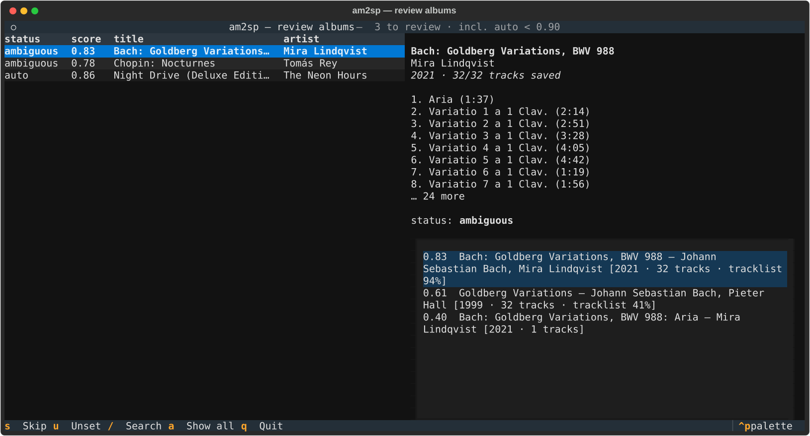
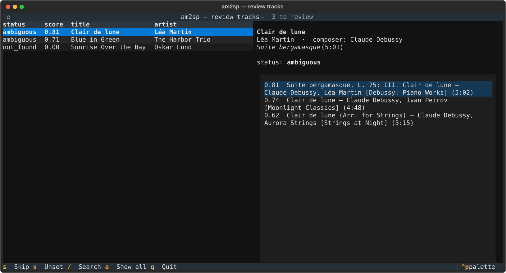

# am2sp — Apple Music → Spotify

Moves your Apple Music **albums** and **playlists** to Spotify. It runs in the terminal, and a small TUI lets you check the matches it isn't sure about.

## The approach: albums and playlists, not individual tracks

A music library is mostly albums you saved and playlists you built. am2sp migrates those two things the way Spotify models them:

| In Apple Music | On Spotify | How it is matched |
|---|---|---|
| An **album** you saved (3 or more of its tracks in your library) | Saved to **Library → Albums** | As a whole album, confirmed against its tracklist |
| A **playlist** you made | A private playlist with the same name and track order | Track by track |
| A library track that is in no saved album and no playlist | Not migrated | — |

Nothing is added to **Liked Songs**.

### Why albums are matched as albums

Matching an album one track at a time is fragile, and classical music is where it breaks. Apple calls a track *"Das Wohltemperierte Klavier: Book 1: 1. Prelude in C Minor BWV 847"*. Spotify calls the same recording *"The Well-Tempered Clavier I: Prelude & Fugue No. 2 in C Minor, BWV 847: I. Prelude"*, and every other prelude in the cycle looks almost the same to a text matcher. Track-by-track matching picks the wrong movement or the wrong pianist.

Matching the album avoids this. am2sp searches Spotify for the album by name and artist. It then fetches the tracklists of the best candidates and checks that your saved tracks are on them, using titles plus durations within 5 seconds. A candidate is only accepted on its own when the album metadata **and** the tracklist agree. The album's own tracks are never matched one by one.

### Why playlists are matched track by track

A playlist is your own sequence of tracks from many albums, so it can only be rebuilt one track at a time. Each track is searched by title, artist, album and duration. Confident matches are accepted automatically, and the rest go to the review TUI.

### Filling gaps in an existing Spotify account

If the Spotify account already has music on it, for example from before you switched to Apple Music, `push` reads it first and only adds what is missing:

- Albums already in Library → Albums are skipped, including albums saved there in another edition (deluxe, remaster…).
- A playlist with the same name as one of your Spotify playlists (ignoring case and accents) is **merged** into it rather than duplicated: only the missing tracks are appended. If several share the name, the largest one is used.
- A track already in that playlist as another release of the same song is not added again. "Same song" means the same title without "Remastered"/"Live" decorations, the same artist, and a length within 15 seconds.
- `push --dry-run` shows all of this before anything is written.

## One-time setup

1. Create an app at <https://developer.spotify.com/dashboard>:
   - Redirect URI: `http://127.0.0.1:8888/callback`. Spotify no longer accepts `localhost`; it has to be `127.0.0.1`.
   - APIs used: Web API.
   - Under *User Management*, add your own Spotify account's email.
   - Since February 2026, Development Mode apps need the app owner to have Spotify Premium.
2. Export your library from Music.app: **File → Library → Export Library…** → `Library.xml`.
3. `uv sync`

## Usage

```sh
uv run am2sp extract Library.xml           # read the export → .am2sp/library.json
uv run am2sp auth --client-id <CLIENT_ID>  # browser login; token cached in ~/.config/am2sp
uv run am2sp match                         # find albums, then playlist tracks, on Spotify
uv run am2sp review --albums               # check the albums it wasn't sure about
uv run am2sp review                        # check the playlist tracks it wasn't sure about
uv run am2sp push --dry-run                # see exactly what would be written
uv run am2sp push                          # write to Spotify (asks for confirmation)
```

Other commands:

```sh
uv run am2sp status                        # match coverage per album/playlist target
uv run am2sp unmatched -o missing.csv      # albums and tracks that won't be pushed
```

Every step is safe to re-run. State lives in `.am2sp/` (gitignored): `library.json`, `albums.json` and `matches.json` (match results), and `push.json` (what has been written).

- `extract` prints how many albums and playlist tracks there are to match, and how many loose library tracks will not be migrated. It leaves out a playlist named "Spotify Liked Songs" (made by tools that copy Spotify likes to Apple Music), since pushing it back would duplicate Liked Songs. Use `--no-default-skips` to keep it, and `-x NAME` to leave out other playlists.
- `match` only searches what it hasn't matched yet. `--limit N` does a trial run, `--retry` re-searches ambiguous and not-found items, and `--no-albums` / `--no-tracks` does one kind only. Spotify gives Development Mode apps a daily request quota. If it runs out, `match` saves its progress, stops, and tells you when to run it again.
- `push` saves after every batch and never writes the same album, playlist or track twice. If you delete an imported playlist on Spotify, the next `push` creates it again.

| `push` option | Effect |
|---|---|
| `-p NAME` (repeatable) | Push only the named playlists |
| `--no-playlists` | Skip playlists |
| `--no-albums` | Skip albums |
| `--public` | Create the playlists as public |

## Reviewing matches

Each match ends up with one of these statuses:

| Status | Meaning |
|---|---|
| `auto` | Confident match, accepted without review |
| `ambiguous` | Plausible candidates, none confident enough: needs a decision |
| `not_found` | No plausible candidate: search manually or skip |
| `manual` | You picked the match in the review TUI |
| `skipped` | You chose to leave it out |

Only `auto` and `manual` matches are pushed. `review` lists the `ambiguous` and `not_found` items. Add `--check-below 0.90` to also double-check `auto` matches that scored below 0.90.

### Albums: `am2sp review --albums`



The left pane lists the albums to review. The right pane shows the album as saved in Apple Music, with its tracklist, and below it the Spotify candidates. Each candidate shows its release year, its track count and, for the top candidates, the share of your saved tracks found on it (`tracklist 94%`). A high tracklist share is the strongest sign you have the right recording.

### Playlist tracks: `am2sp review`



The same layout, for one playlist track at a time: the Apple track (artist, composer, album, length) and the Spotify candidates with their album and length.

### Keys

| Key | Action |
|---|---|
| `↑` / `↓` | Move through the list |
| `Tab` | Switch to the candidate list |
| `Enter` | Accept the highlighted candidate (marks it `manual`) |
| `s` | Skip (it won't be pushed) |
| `u` | Unset the match |
| `/` | Search Spotify, or paste an `open.spotify.com/track/…` (or `/album/…`) link |
| `a` | Show everything, including `auto` matches, to audit them |
| `q` | Quit |

Every decision is saved immediately, so you can quit and come back later. A resolved item leaves the list.

The screenshots use invented demo data. To regenerate them, run `uv run python scripts/screenshots.py`.
